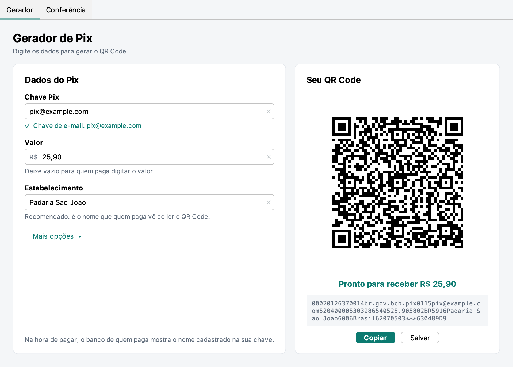
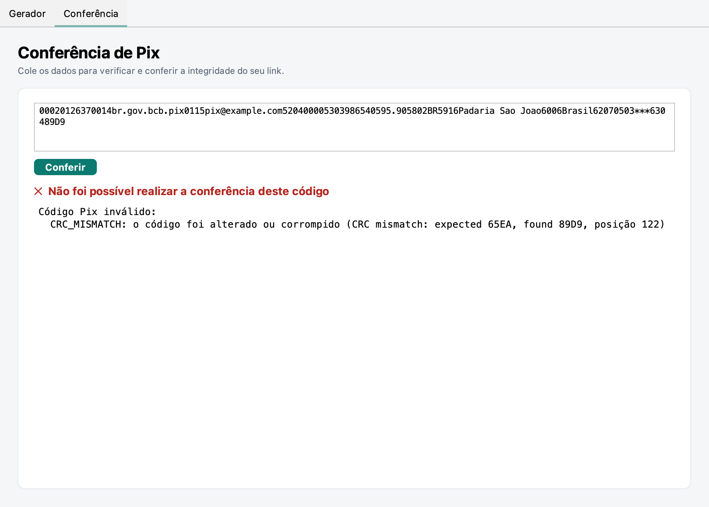
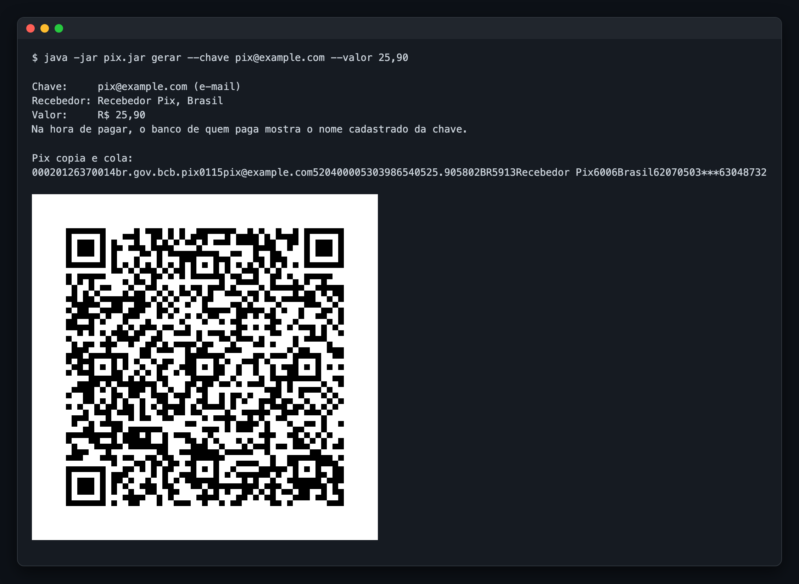

# pix-brcode-java

[](https://github.com/Hitice/pix-brcode-java/actions/workflows/ci.yml)
[](https://jitpack.io/#Hitice/pix-brcode-java)
[](LICENSE)

**Gere, leia e valide o código do Pix dentro do seu sistema Java**, do jeito que o Banco Central
especifica e sem depender da API de um banco para cada cobrança simples.

```java
String copiaECola = BrCode.staticPayment()
        .key("financeiro@sualoja.com.br")
        .merchantName("Sua Loja")
        .merchantCity("Uberlandia")
        .amount(new BigDecimal("149.90"))
        .txid("PEDIDO4821")
        .build()
        .payload();
```

## Para quem é

Para quem desenvolve sistemas que **recebem ou repassam pagamentos por Pix**: ERP, PDV, loja
virtual, sistema de cobrança, emissor de nota, aplicativo de delivery, conta a pagar.

| Você precisa | Esta biblioteca resolve |
| --- | --- |
| Mostrar um QR Code com o valor do pedido na tela, no e-mail ou impresso | Gera o copia e cola e a imagem do QR com valor e número do pedido dentro |
| Casar o pagamento recebido com o pedido | Coloca o número do pedido (`txid`) no código, que viaja junto com o pagamento |
| Aceitar um copia e cola colado por um cliente ou fornecedor | Lê os campos e aponta se o código foi alterado ou está malformado, antes de pagar |
| Cadastrar a chave Pix de um vendedor, fornecedor ou parceiro | Valida e normaliza a chave: CPF, CNPJ (inclusive o novo com letras), e-mail, celular, aleatória |
| Exibir o QR de uma cobrança criada na API do seu banco | Monta o código dinâmico a partir do endereço que o banco devolve, ou confere o que ele mandou |

### Antes de escolher, o que ela não faz

O código Pix é só a "etiqueta" do pagamento. Esta biblioteca **não fala com bancos**:

- **Não confirma o pagamento.** Para saber que o dinheiro caiu, use a API Pix ou o webhook do seu
  banco. O `txid` que você coloca no código é o que liga as duas pontas.
- **Não cria cobrança dinâmica.** A cobrança (com vencimento, juros, devedor) é criada na API do
  seu banco; a biblioteca monta ou confere o código que aponta para ela.
- **Não descobre o nome do dono de uma chave.** Isso exige o DICT do Banco Central, acesso exclusivo
  de bancos.

Se o seu caso é só "mostrar um QR com valor e conferir depois pelo extrato ou pela API do banco", o
**Pix estático** desta biblioteca resolve sem custo por cobrança e sem integração com o banco.

## Instalação

Requer **Java 21** ou mais novo. A biblioteca é publicada pelo
[JitPack](https://jitpack.io/#Hitice/pix-brcode-java); a publicação no Maven Central está a
caminho.

Maven:

```xml
<repositories>
  <repository>
    <id>jitpack.io</id>
    <url>https://jitpack.io</url>
  </repository>
</repositories>

<dependencies>
  <dependency>
    <groupId>com.github.Hitice.pix-brcode-java</groupId>
    <artifactId>pix-brcode</artifactId>
    <version>v0.2.0</version>
  </dependency>
  <!-- Opcional: imagem do QR Code em PNG ou SVG -->
  <dependency>
    <groupId>com.github.Hitice.pix-brcode-java</groupId>
    <artifactId>pix-brcode-qrcode</artifactId>
    <version>v0.2.0</version>
  </dependency>
</dependencies>
```

Gradle (Kotlin DSL):

```kotlin
repositories {
    mavenCentral()
    maven("https://jitpack.io")
}

dependencies {
    implementation("com.github.Hitice.pix-brcode-java:pix-brcode:v0.2.0")
    implementation("com.github.Hitice.pix-brcode-java:pix-brcode-qrcode:v0.2.0") // opcional
}
```

O núcleo (`pix-brcode`) não tem nenhuma dependência. O módulo de QR (`pix-brcode-qrcode`) traz só o
ZXing core. Com JPMS: `requires io.github.hitice.pix.brcode;` (ou `io.github.hitice.pix.brcode.qrcode`,
que já inclui o núcleo).

## Como integrar

### 1. Cobrar um pedido com QR Code

O caso mais comum: o cliente fecha o pedido e você mostra o QR com o valor exato.

```java
import io.github.hitice.pix.brcode.BrCode;
import io.github.hitice.pix.brcode.qrcode.BrCodeQr;

BrCode pix = BrCode.staticPayment()
        .key(config.chavePix())              // a chave da empresa, cadastrada no banco
        .merchantName(config.nomeFantasia()) // até 25 caracteres; acentos são removidos
        .merchantCity(config.cidade())       // até 15 caracteres
        .amount(pedido.total())              // BigDecimal; sem valor, quem paga digita
        .txid(pedido.codigo())               // até 25 letras e números, sem espaço ou hífen
        .build();

String copiaECola = pix.payload();           // para o botão "copiar" e para o e-mail
byte[] png = BrCodeQr.of(pix).toPng(8);      // 8 pixels por módulo
String svg = BrCodeQr.of(pix).toSvg(8);      // para páginas web e impressão
```

Num endpoint REST (Spring Boot, por exemplo):

```java
@GetMapping(value = "/pedidos/{id}/pix.png", produces = MediaType.IMAGE_PNG_VALUE)
byte[] qrDoPedido(@PathVariable String id) {
    Pedido pedido = pedidos.buscar(id);
    BrCode pix = BrCode.staticPayment()
            .key(config.chavePix())
            .merchantName(config.nomeFantasia())
            .merchantCity(config.cidade())
            .amount(pedido.total())
            .txid(pedido.codigo())
            .build();
    return BrCodeQr.of(pix).toPng(8);
}
```

### 2. Saber que o pedido foi pago

O `txid` que você colocou no código chega junto com o pagamento. Na maioria dos bancos, ele aparece
na consulta de Pix recebidos da API Pix (`GET /pix`) e no webhook de recebimento. Busque por ele e
dê baixa no pedido. Sem API, ele também ajuda a conciliar pelo extrato.

### 3. Exibir uma cobrança criada no banco (Pix dinâmico)

Quando você cria a cobrança na API Pix do seu banco (`PUT /cob/{txid}`), ele devolve um endereço
(`location`). Monte o código com ele:

```java
BrCode pix = BrCode.dynamicPayment()
        .location(resposta.location())       // sem "https://"
        .merchantName(config.nomeFantasia())
        .merchantCity(config.cidade())
        .build();
```

Muitos bancos já devolvem o campo `pixCopiaECola` pronto. Nesse caso, use a biblioteca para conferir
esse texto (passo 4) e gerar a imagem com `BrCodeQr`.

### 4. Conferir um copia e cola recebido

Antes de pagar um código que chegou de fora, ou de gravar um código vindo de outro sistema:

```java
ValidationResult resultado = BrCode.validate(textoColado);
if (!resultado.isValid()) {
    for (Problem p : resultado.problems()) {
        log.warn("{} na posição {}: {}", p.code(), p.position(), p.message());
    }
    return;
}
BrCode pix = BrCode.parse(textoColado);
pix.key();          // Optional<PixKey>: para quem vai o dinheiro
pix.amount();       // Optional<BigDecimal>
pix.txid();         // Optional<String>
pix.merchantName();
```

`validate` lista todos os problemas, sem lançar exceção. `parse` devolve o código já separado em
campos ou lança `BrCodeException` com o primeiro problema. Um caractere alterado (o valor, por
exemplo) quebra o CRC e é sempre detectado.

### 5. Validar a chave Pix num cadastro

```java
try {
    PixKey chave = PixKey.of(formulario.chave());   // descobre o tipo
    fornecedor.setChavePix(chave.value());          // valor normalizado, como vai no código
    fornecedor.setTipoChave(chave.type());          // CPF, CNPJ, EMAIL, PHONE ou EVP
} catch (IllegalArgumentException e) {
    erros.add("chavePix", e.getMessage());
}
```

## Configuração e boas práticas

| Ponto | Recomendação |
| --- | --- |
| **Nome e cidade** | Use o nome fantasia e a cidade reais. São informativos (o banco de quem paga mostra o nome cadastrado na chave), mas um nome reconhecível passa confiança. Passou de 25 ou 15 caracteres, o builder lança `IllegalArgumentException`: corte antes. |
| **`txid`** | Use o número do pedido, com até 25 letras e números. É o que permite conciliar. Sem `txid`, o código leva `***`. |
| **Valor** | `BigDecimal`. Mais de 2 casas decimais é recusado, não arredondado. Sem valor, quem paga digita. |
| **Erros** | Argumento inválido: `IllegalArgumentException`. Campo obrigatório ausente no `build()`: `IllegalStateException`. Código inválido na leitura: `BrCodeException` (ou a lista do `validate`). |
| **Concorrência** | `BrCode`, `PixKey`, `Problem` e `ValidationResult` são imutáveis e podem ser compartilhados entre threads. Os builders não. |
| **Igualdade** | Dois códigos são iguais quando o copia e cola é igual. Um código lido guarda exatamente o texto de origem. |
| **Tamanho do QR** | `toPng(8)` gera de 400 a 460 px para um código comum, bom para tela. Para impressão, use 10 a 12, ou o SVG. |

## Qualidade

| | |
| --- | --- |
| **Fonte da verdade** | Os 5 exemplos do Manual de Padrões para Iniciação do Pix (v2.10.0) e o do Manual do BR Code (v2.0.1) saem desta biblioteca **byte a byte iguais**, e são testes automáticos. |
| **Erros achados nos manuais** | O exemplo do Manual do BR Code usa um `txid` com hífen, que a regra do Pix estático proíbe; o CPF de exemplo do manual do Pix tem dígitos verificadores errados. Os dois estão documentados nos testes. |
| **CNPJ alfanumérico** | Validado com os 9 vetores de teste da rotina oficial do Serpro, pela regra da Receita Federal (IN RFB 2.229/2024), em vigor desde julho de 2026. |
| **Testes** | 331 testes: 288 no núcleo, 15 no módulo de QR, 28 no programa. Cobertura do núcleo: 99,8% das linhas e 97,8% dos desvios. O build falha abaixo de 85%. |
| **Testes de propriedade** | 5.000 códigos estáticos e 5.000 dinâmicos aleatórios ida e volta, e 5.000 alterações de um caractere que o leitor sempre recusa. |
| **Imagem do QR** | Cada QR gerado é lido de volta com o ZXing nos 4 níveis de correção de erro. |
| **Engenharia** | Java 21, núcleo sem dependências, módulos JPMS, objetos imutáveis, sem `null` na API, CI a cada commit, compilação com todos os avisos tratados como erro. |

## Como funciona o código Pix

O copia e cola é um texto só, montado em campos no formato **ID, tamanho e valor**: dois dígitos
dizem qual é o campo, dois dígitos dizem quantos caracteres vêm a seguir, e depois vem o valor.

```
00020126510014br.gov.bcb.pix0115pix@example.com0210Pedido 123520400005303986540512.345802BR5916Padaria Sao Joao6009Sao Paulo62130509PEDIDO1236304BD94
```

| ID | Tamanho | Valor | O que é |
| --- | --- | --- | --- |
| `00` | `02` | `01` | Versão do formato, sempre `01` e sempre o primeiro campo |
| `26` | `51` | (os três subcampos abaixo) | Dados da conta de quem recebe |
| `  00` | `14` | `br.gov.bcb.pix` | Identifica que é um Pix |
| `  01` | `15` | `pix@example.com` | A chave Pix |
| `  02` | `10` | `Pedido 123` | Mensagem para quem paga |
| `52` | `04` | `0000` | Categoria do comerciante (`0000` quando não se aplica) |
| `53` | `03` | `986` | Moeda: 986 é o real |
| `54` | `05` | `12.34` | Valor, com ponto; sem este campo, quem paga digita |
| `58` | `02` | `BR` | País |
| `59` | `16` | `Padaria Sao Joao` | Nome de quem recebe |
| `60` | `09` | `Sao Paulo` | Cidade de quem recebe |
| `62` | `13` | `0509PEDIDO123` | Dados adicionais: o subcampo `05` é o identificador (`txid`) |
| `63` | `04` | `BD94` | CRC: o dígito verificador do código inteiro |

- **CRC:** os 4 últimos caracteres são um cálculo (CRC-16) sobre todo o resto. Mudar um caractere
  faz o CRC não bater, e o banco recusa o código. É assim que a adulteração é detectada.
- **Estático e dinâmico:** no estático, chave e valor estão dentro do código, que pode ser impresso
  e reaproveitado. No dinâmico, o código traz só um endereço (campo `25` no lugar da chave) onde o
  banco serve a cobrança.
- **Acentos:** nome e cidade aceitam só ASCII, pela especificação EMV. "São Paulo" vira "Sao Paulo".

## Programa de demonstração

O repositório traz um programa pronto, útil para testar uma chave, gerar QR no computador do balcão
ou conferir um código suspeito. Baixe o `pix.jar` da
[última versão](https://github.com/Hitice/pix-brcode-java/releases/latest) e abra com Java 21
(dois cliques, ou `java -jar pix.jar janela`).



A aba **Conferência** mostra para quem vai o dinheiro, ou aponta o problema:



Também funciona pelo terminal, para scripts e servidores sem tela:

```bash
java -jar pix.jar gerar --chave voce@exemplo.com --valor 0,01 --png qr.png
java -jar pix.jar ler "00020126...6304ABCD"
```



| Opção de `gerar` | Para que serve |
| --- | --- |
| `--chave` | Chave Pix de quem recebe (a única obrigatória) |
| `--valor` | Valor em reais (`12,34`, `12.34` ou `R$ 1.234,56`); sem ele, quem paga digita |
| `--nome` | Nome do estabelecimento, até 25 caracteres (recomendado) |
| `--cidade` | Cidade, até 15 caracteres |
| `--txid` | Identificador do pedido, letras e números, até 25 |
| `--descricao` | Mensagem para quem paga |
| `--png`, `--svg` | Salva o QR Code no arquivo indicado |
| `--sem-qr` | Não desenha o QR no terminal |

No Mac, o dois cliques precisa de um Java instalado no sistema (por exemplo o
[Temurin 21](https://adoptium.net/)); com o Java só da IDE, abra pelo Terminal.

## Referência

### Chaves Pix

`PixKey.of(String)` descobre o tipo. As funções específicas aceitam o texto formatado e
normalizam. Uma `PixKey` sempre guarda o valor que vai escrito no código.

| Tipo | Função | Aceita | Valor guardado |
| --- | --- | --- | --- |
| CPF | `PixKey.cpf` | `123.456.789-09`, `12345678909` | 11 dígitos, verificadores conferidos, números repetidos recusados |
| CNPJ | `PixKey.cnpj` | `12.ABC.345/01DE-35`, `00038166000105` | 12 caracteres `[0-9A-Z]` e 2 verificadores; numérico e alfanumérico |
| E-mail | `PixKey.email` | `Pix@Example.com` | minúsculas, até 77 caracteres, expressão regular do DICT |
| Celular | `PixKey.phone` | `+55 (61) 91234-5678`, `61912345678` | `+55`, DDD e celular de 9 dígitos começando por 9 |
| Chave aleatória | `PixKey.evp` | UUID em qualquer caixa, ou `java.util.UUID` | UUID em minúsculas, com hífens |

Como o `PixKey.of` decide: `@` indica e-mail; `+` no começo indica celular; um UUID indica chave
aleatória; depois de tirar `. / -` e espaços, 11 dígitos indicam CPF e 14 caracteres indicam CNPJ.
Um celular sem o `+55` seria lido como CPF; para ele, use `PixKey.phone`.

### Categorias de problema (`ErrorCode`)

| Categoria | Significado |
| --- | --- |
| `TRUNCATED` | O código termina antes do fim de um campo |
| `MALFORMED_TLV` | Um campo não segue o formato ID, tamanho e valor |
| `INVALID_LENGTH` | Um campo passa do tamanho permitido |
| `DUPLICATE_ID` | O mesmo campo aparece duas vezes |
| `UNKNOWN_ID` | Campo que a especificação não define |
| `MISPLACED_FIELD` | Campo fora da posição obrigatória (o `00` vem primeiro, o `63` por último) |
| `MISSING_FIELD` | Falta um campo obrigatório |
| `INVALID_VALUE` | Valor fora do permitido para o campo |
| `INVALID_CHARACTER` | Caractere que o campo não aceita |
| `CRC_MISMATCH` | O CRC não bate: o código foi alterado ou corrompido |
| `INVALID_KEY` | Chave Pix inválida |
| `INVALID_AMOUNT` | Valor em reais inválido |
| `INVALID_TXID` | Identificador da cobrança inválido |
| `CONFLICTING_FIELDS` | Campos que não podem aparecer juntos |
| `NOT_PIX` | Não é um código Pix |

O leitor aceita o que a especificação permite mesmo que o gerador nunca produza: modelos de outros
arranjos de pagamento, o modelo Pix em qualquer ID de 26 a 51, o identificador em maiúsculas,
valores escritos como `98` ou `98.`, CEP, campos de gorjeta e o modelo de idioma.

### Regras implementadas

Do Manual do BR Code, do Manual de Padrões para Iniciação do Pix e da especificação EMV QRCPS MPM:

- Cada campo é ID (2 dígitos), tamanho (2 dígitos, de 01 a 99) e valor; o tamanho conta caracteres.
- O `00` (versão, valor `01`) vem primeiro; o `63` (CRC) vem por último.
- O `01` (forma de iniciação) é opcional: `11` reutilizável, `12` uso único.
- Um modelo de conta entre 26 e 51 traz `br.gov.bcb.pix` no `00` e a chave no `01` (estático) ou o
  endereço no `25` (dinâmico); chave (até 77), mensagem `02` (até 72) e facilitador de saque `03`
  dividem os 99 caracteres do modelo.
- `52` categoria (`0000` por padrão), `53` moeda `986`, `58` país `BR`.
- `54` valor: opcional, até 13 caracteres, no máximo 2 casas, diferente de zero.
- `59` nome com até 25 e `60` cidade com até 15 caracteres, ASCII imprimível; o gerador remove os
  acentos e mantém maiúsculas e minúsculas.
- `62` dados adicionais com o `05` identificador: no estático, até 25 caracteres `A-Z a-z 0-9` ou
  `***`.
- `80` a `99` com o identificador Pix e o `25`: endereço de recorrência (Pix Automático).
- `63` CRC-16/CCITT-FALSE (polinômio `0x1021`, inicial `0xFFFF`) sobre o código até `6304`
  inclusive, em 4 dígitos hexadecimais maiúsculos.

### Documentos usados

| Documento | Versão | Usado para |
| --- | --- | --- |
| [Manual de Padrões para Iniciação do Pix](https://www.bcb.gov.br/content/estabilidadefinanceira/pix/Regulamento_Pix/II_ManualdePadroesparaIniciacaodoPix.pdf), Banco Central | 2.10.0 | Modelo Pix, formato das chaves, regras do identificador, exemplos das seções 2.6.3, 2.7.2 e 2.8.5 |
| [Manual do BR Code](https://www.bcb.gov.br/content/estabilidadefinanceira/spb_docs/ManualBRCode.pdf), Banco Central | 2.0.1 | Campos comuns, `62-05` obrigatório, exemplo da seção 2.2 |
| [EMV QR Code, Merchant-Presented Mode](https://www.emvco.com/emv-technologies/qr-codes/), EMVCo | 1.1 | Formato dos campos, ordem, valor, CRC, modo byte e ECI UTF-8 |
| [Manual Operacional do DICT](https://www.bcb.gov.br/content/estabilidadefinanceira/pix/Regulamento_Pix/X_ManualOperacionaldoDICT.pdf), Banco Central | 8.5 | Tipos e formatos de chave, chave CNPJ alfanumérica |
| [API do DICT](https://github.com/bacen/pix-dict-api), Banco Central | 1.8.0 | Expressões regulares de e-mail e chave aleatória |
| [CNPJ alfanumérico](https://www.gov.br/receitafederal/pt-br/centrais-de-conteudo/publicacoes/perguntas-e-respostas/cnpj/cnpj-alfanumerico.pdf), Receita Federal | abril de 2026 | Formato e dígito verificador do CNPJ alfanumérico |
| [Rotinas de validação](https://www.serpro.gov.br/menu/noticias/videos/cnpj-alfanumerico.zip), Serpro | 2022 | Implementação de referência e vetores de teste |

## Compilar e testar

```bash
./mvnw verify                      # testes, cobertura mínima de 85% e javadoc
./mvnw -q package -DskipTests      # gera pix-brcode-cli/target/pix.jar
```

| Módulo | O que é |
| --- | --- |
| `pix-brcode` | Núcleo: gerar, ler e validar; sem dependências |
| `pix-brcode-qrcode` | Imagem do QR Code em PNG e SVG, com ZXing |
| `pix-brcode-cli` | Programa com janela e terminal (`pix.jar`); não é publicado no Maven |
| `examples` | Exemplo executável em Java |

## Contribuir

Veja o [CONTRIBUTING.md](CONTRIBUTING.md). Os passos para publicar uma versão estão no
[RELEASING.md](RELEASING.md).

## Licença

[MIT](LICENSE), Copyright (c) 2026 Pedro Henrique Fernandes.
