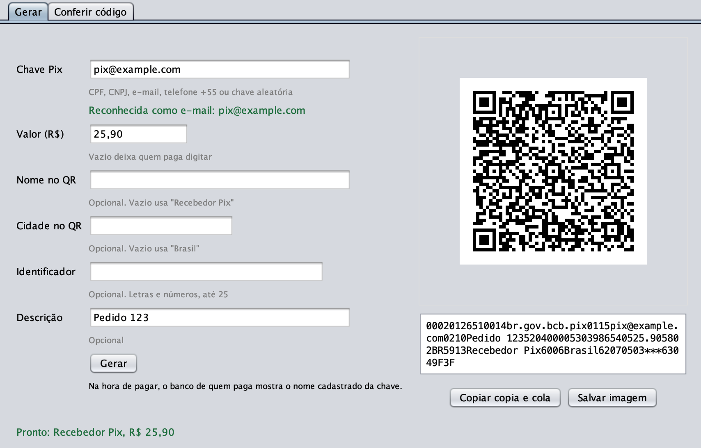
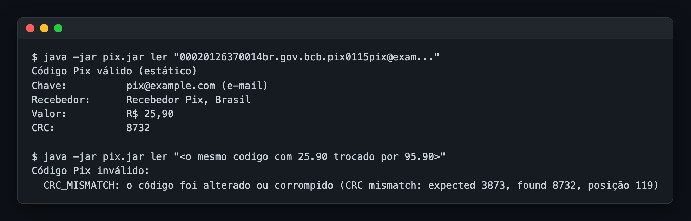

# pix-brcode-java

[](https://github.com/Hitice/pix-brcode-java/actions/workflows/ci.yml)
[](https://jitpack.io/#Hitice/pix-brcode-java)
[](LICENSE)

Biblioteca Java para **gerar, ler e validar o código do Pix**: o texto do "Pix copia e cola" e o
QR Code que o app do banco lê. Segue os manuais do Banco Central do Brasil e a especificação EMV de
QR Code em que eles se baseiam, e vem com um programa pronto para gerar e conferir Pix, com janela
ou pelo terminal.



## O que tem aqui

- **Gera** códigos estáticos (a chave vai dentro do código) e dinâmicos (o código aponta para uma
  cobrança criada no seu banco), inclusive o código composto com recorrência do Pix Automático.
- **Lê** qualquer copia e cola e devolve os campos já separados: chave, valor, recebedor, cidade,
  identificador.
- **Valida** e aponta cada problema com a posição exata no texto, inclusive código adulterado.
- **Confere as chaves Pix:** CPF, CNPJ numérico e o **CNPJ alfanumérico** em vigor desde julho de
  2026, e-mail, telefone e chave aleatória.
- **Desenha o QR Code** em PNG ou SVG (módulo opcional), na janela do programa ou direto no
  terminal.
- **Núcleo sem nenhuma dependência**, Java 21, módulo JPMS `io.github.hitice.pix.brcode`.

Os exemplos impressos no manual do Pix saem desta biblioteca **byte a byte iguais**, e fazem parte
dos testes automáticos.

## Usar o programa

Baixe o `pix.jar` da [última versão](https://github.com/Hitice/pix-brcode-java/releases/latest) e
abra com Java 21. Ou compile você mesmo:

```bash
git clone https://github.com/Hitice/pix-brcode-java.git
cd pix-brcode-java
./mvnw -q package -DskipTests        # gera pix-brcode-cli/target/pix.jar
```

O `./mvnw` baixa o Maven sozinho na primeira vez; não precisa instalar nada além do Java.

### Com janela

Abra o `pix.jar` com dois cliques, ou rode `java -jar pix.jar janela`.

1. Digite a **chave Pix**. O programa reconhece o tipo enquanto você digita (CPF, CNPJ, e-mail,
   telefone ou chave aleatória) e avisa se ela estiver errada.
2. Digite o **valor**, se quiser. Aceita `0,01`, `0.01` e `R$ 1.234,56`; vazio deixa quem paga
   digitar.
3. Clique em **Gerar**. O QR Code aparece na tela, com o copia e cola embaixo.
4. Use **Copiar copia e cola** para mandar por mensagem, ou **Salvar imagem** para imprimir.

Nome, cidade, identificador e descrição são opcionais. A aba **Conferir código** recebe um copia e
cola qualquer e mostra os campos, ou o que está errado nele.


No Mac, o dois cliques precisa de um Java instalado no sistema (por exemplo o
[Temurin 21](https://adoptium.net/)). Se o Java estiver só na pasta do usuário, como o que vem com
as IDEs da JetBrains, abra pelo Terminal com `java -jar pix.jar janela`.

### Pelo terminal

`java -jar pix.jar` no terminal faz as perguntas na ordem: a chave (obrigatória), o valor e os
campos opcionais, em que Enter pula. Depois mostra o copia e cola, desenha o QR Code no próprio
terminal e salva `pix.png` na pasta atual.


Tudo numa linha, ou para conferir um código que alguém te mandou:

```bash
java -jar pix.jar gerar --chave voce@exemplo.com --valor 0,01 --png qr.png
java -jar pix.jar ler "00020126...6304ABCD"
```

| Opção de `gerar` | Para que serve |
| --- | --- |
| `--chave` | Chave Pix de quem recebe (a única obrigatória) |
| `--valor` | Valor em reais; sem ele, quem paga digita |
| `--nome` | Nome no QR, até 25 caracteres; sem ele, usa "Recebedor Pix" |
| `--cidade` | Cidade no QR, até 15 caracteres; sem ela, usa "Brasil" |
| `--txid` | Identificador da cobrança, letras e números, até 25 |
| `--descricao` | Texto que aparece para quem paga |
| `--png`, `--svg` | Salva o QR Code no arquivo indicado |
| `--sem-qr` | Não desenha o QR no terminal |

Os comandos e opções também aceitam os nomes em inglês (`generate`, `read`, `window`, `--key`,
`--amount`...).

O `ler` mostra os campos de um código válido e, num código adulterado, diz o que está errado e onde:



### Teste com o seu banco

Use a sua própria chave e o valor `0,01`, aponte a câmera do app do banco para a tela ou para a
imagem e confira se aparecem o valor e o seu nome. Se pagar, o centavo volta para você mesmo.

### Por que o programa não busca o nome e o banco pela chave

O app do banco mostra o nome do dono da chave porque consulta o **DICT**, o diretório de chaves do
Banco Central. Esse acesso é exclusivo dos bancos e instituições participantes do Pix, exige
certificado ICP-Brasil e conexão autenticada, e é vigiado para impedir que alguém descubra nomes a
partir de chaves, que são dado pessoal. Não existe consulta pública, então um programa aberto não
tem como fazer isso.

E não faz falta: num código estático, o nome e a cidade escritos no QR são informativos. Na hora de
pagar, o banco de quem paga consulta o DICT e mostra o nome verdadeiro do dono da chave antes da
confirmação. Por isso aqui eles são opcionais.

## Como funciona o código Pix

O copia e cola é um texto só, montado em campos no formato **ID, tamanho e valor**: dois dígitos
dizem qual é o campo, dois dígitos dizem quantos caracteres vêm a seguir, e depois vem o valor. Este
é o código gerado no exemplo de uso mais abaixo:

```
00020126510014br.gov.bcb.pix0115pix@example.com0210Pedido 123520400005303986540512.345802BR5916Padaria Sao Joao6009Sao Paulo62130509PEDIDO1236304BD94
```

Separado campo a campo:

| ID | Tamanho | Valor | O que é |
| --- | --- | --- | --- |
| `00` | `02` | `01` | Versão do formato, sempre `01` e sempre o primeiro campo |
| `26` | `51` | (os três subcampos abaixo) | Dados da conta de quem recebe |
| `  00` | `14` | `br.gov.bcb.pix` | Identifica que é um Pix |
| `  01` | `15` | `pix@example.com` | A chave Pix |
| `  02` | `10` | `Pedido 123` | Descrição para quem paga |
| `52` | `04` | `0000` | Categoria do comerciante (`0000` quando não se aplica) |
| `53` | `03` | `986` | Moeda: 986 é o real |
| `54` | `05` | `12.34` | Valor, com ponto; sem este campo, quem paga digita |
| `58` | `02` | `BR` | País |
| `59` | `16` | `Padaria Sao Joao` | Nome de quem recebe |
| `60` | `09` | `Sao Paulo` | Cidade de quem recebe |
| `62` | `13` | `0509PEDIDO123` | Dados adicionais: o subcampo `05` é o identificador da cobrança |
| `63` | `04` | `BD94` | CRC, o dígito verificador do código inteiro |

Alguns pontos que costumam confundir:

- **CRC:** os 4 últimos caracteres são um cálculo (CRC-16) sobre todo o resto do texto. Mudar um único
  caractere, como o valor, faz o CRC não bater, e o app do banco recusa o código. É assim que a
  biblioteca detecta adulteração.
- **Estático e dinâmico:** no estático, a chave e o valor estão dentro do código, que pode ser
  impresso e reaproveitado. No dinâmico, o código só traz um endereço (campo `25` em vez da chave)
  onde o banco de quem recebe serve a cobrança; o valor e os dados ficam lá. Esta biblioteca monta
  o código dinâmico, mas a cobrança em si é criada na API Pix do seu banco.
- **Acentos:** nome e cidade aceitam só caracteres ASCII, pela especificação EMV. Por isso
  "Uberlândia" vira "Uberlandia" e "São Paulo" vira "Sao Paulo" no código.
- **Sem identificador:** quando não há identificador, o campo `62` leva `***`.

## Instalação

A publicação no Maven Central está pendente. Até lá, use o JitPack, que compila a biblioteca direto a
partir de uma tag do Git.

### JitPack

Maven:

```xml
<repositories>
  <repository>
    <id>jitpack.io</id>
    <url>https://jitpack.io</url>
  </repository>
</repositories>

<dependency>
  <groupId>com.github.Hitice.pix-brcode-java</groupId>
  <artifactId>pix-brcode</artifactId>
  <version>v0.1.0</version>
</dependency>
<!-- Opcional, para gerar a imagem do QR Code -->
<dependency>
  <groupId>com.github.Hitice.pix-brcode-java</groupId>
  <artifactId>pix-brcode-qrcode</artifactId>
  <version>v0.1.0</version>
</dependency>
```

Gradle (Kotlin DSL):

```kotlin
repositories {
    mavenCentral()
    maven("https://jitpack.io")
}

dependencies {
    implementation("com.github.Hitice.pix-brcode-java:pix-brcode:v0.1.0")
    implementation("com.github.Hitice.pix-brcode-java:pix-brcode-qrcode:v0.1.0") // opcional
}
```

### Maven Central (depois da primeira versão)

Maven:

```xml
<dependency>
  <groupId>io.github.hitice</groupId>
  <artifactId>pix-brcode</artifactId>
  <version>0.1.0</version>
</dependency>
<!-- Opcional, para gerar a imagem do QR Code -->
<dependency>
  <groupId>io.github.hitice</groupId>
  <artifactId>pix-brcode-qrcode</artifactId>
  <version>0.1.0</version>
</dependency>
```

Gradle (Kotlin DSL):

```kotlin
dependencies {
    implementation("io.github.hitice:pix-brcode:0.1.0")
    implementation("io.github.hitice:pix-brcode-qrcode:0.1.0") // opcional
}
```

Com JPMS, adicione `requires io.github.hitice.pix.brcode;` (ou `io.github.hitice.pix.brcode.qrcode`,
que já inclui o núcleo).

## Uso no código

Código estático: a chave e os dados do pagamento vão dentro do código.

```java
import io.github.hitice.pix.brcode.BrCode;
import io.github.hitice.pix.brcode.PixKey;
import io.github.hitice.pix.brcode.qrcode.BrCodeQr;
import java.math.BigDecimal;
import java.nio.file.Path;

BrCode code = BrCode.staticPayment()
        .key(PixKey.email("pix@example.com"))     // ou .key("pix@example.com") para detectar o tipo
        .merchantName("Padaria Sao Joao")
        .merchantCity("São Paulo")                 // o acento é removido: "Sao Paulo"
        .amount(new BigDecimal("12.34"))           // opcional; sem ele, quem paga digita o valor
        .txid("PEDIDO123")                         // opcional; sem ele, o código leva ***
        .description("Pedido 123")                 // opcional
        .build();

String copiaECola = code.payload();               // o texto da tabela acima

BrCodeQr.of(code).writePng(Path.of("pix.png"), 8);   // 8 pixels por módulo do QR
String svg = BrCodeQr.of(code).toSvg(8);
```

Código dinâmico: o código traz o endereço onde o seu banco serve a cobrança, criada antes pela API
Pix dele. O endereço vai sem `https://`.

```java
BrCode dynamic = BrCode.dynamicPayment()
        .location("pix.example.com/qr/v2/9d36b84fc70b478fb95c12729b90ca25")
        .merchantName("Padaria Sao Joao")
        .merchantCity("Sao Paulo")
        .build();
```

## Ler e validar

`parse` devolve o código já separado em campos, ou lança `BrCodeException` com o primeiro problema
encontrado:

```java
BrCode code = BrCode.parse(copiaECola);

code.type();                 // STATIC, DYNAMIC ou RECURRENCE_ONLY
code.key();                  // Optional<PixKey>
code.location();             // Optional<String>, nos códigos dinâmicos
code.amount();               // Optional<BigDecimal>, com 2 casas
code.txid();                 // Optional<String>, vazio quando é ***
code.merchantName();
code.merchantCity();
code.recurrenceLocation();   // Optional<String>, nos códigos com recorrência
```

`validate` nunca lança exceção por código inválido e lista todos os problemas, cada um com a
categoria e a posição (contada a partir de zero):

```java
// O código do exemplo com o nome trocado por um de 26 caracteres, sem recalcular o CRC.
String editado = code.payload().replace("5916Padaria Sao Joao", "5926Padaria Sao Joao Ltda XYZ1");

ValidationResult result = BrCode.validate(editado);
if (!result.isValid()) {
    for (Problem p : result.problems()) {
        System.out.println(p.code() + " na posição " + p.position() + ": " + p.message());
    }
}
// CRC_MISMATCH na posição 155: CRC mismatch: expected A5F3, found BD94
// INVALID_LENGTH na posição 93: Merchant name (59) has 26 characters, the maximum is 25
```

As mensagens da biblioteca são em inglês, para quem integra; a ferramenta de linha de comando
explica cada categoria em português.

| Categoria (`ErrorCode`) | Significado |
| --- | --- |
| `TRUNCATED` | O código termina antes do fim de um campo |
| `MALFORMED_TLV` | Um campo não segue o formato ID, tamanho e valor |
| `INVALID_LENGTH` | Um campo passa do tamanho permitido |
| `DUPLICATE_ID` | O mesmo campo aparece duas vezes |
| `UNKNOWN_ID` | Campo que a especificação não define |
| `MISPLACED_FIELD` | Campo fora da posição obrigatória (o `00` vem primeiro, o `63` por último) |
| `MISSING_FIELD` | Falta um campo obrigatório |
| `INVALID_VALUE` | Valor fora do permitido para o campo |
| `INVALID_CHARACTER` | Caractere que o campo não aceita |
| `CRC_MISMATCH` | O CRC não bate: o código foi alterado ou corrompido |
| `INVALID_KEY` | Chave Pix inválida |
| `INVALID_AMOUNT` | Valor em reais inválido |
| `INVALID_TXID` | Identificador da cobrança inválido |
| `CONFLICTING_FIELDS` | Campos que não podem aparecer juntos |
| `NOT_PIX` | Não é um código Pix |

Os problemas de estrutura aparecem primeiro, depois o CRC, depois as regras de cada campo.

O leitor aceita o que a especificação permite, mesmo que o gerador desta biblioteca nunca produza:
modelos de outros arranjos de pagamento (bandeiras de cartão, IDs 02 a 51 e 80 a 99), o modelo Pix em
qualquer ID de 26 a 51, o identificador `BR.GOV.BCB.PIX` em maiúsculas, valores escritos como `98` ou
`98.`, CEP, campos de gorjeta (55 a 57) e o modelo de idioma (64).

## Chaves Pix

`PixKey.of(String)` descobre o tipo sozinho. As funções específicas aceitam o texto formatado e
normalizam. Uma `PixKey` sempre guarda o valor canônico, que é o que vai escrito no código.

| Tipo | Função | Aceita | Valor guardado |
| --- | --- | --- | --- |
| CPF | `PixKey.cpf` | `123.456.789-09`, `12345678909` | 11 dígitos, dígitos verificadores conferidos, números repetidos recusados |
| CNPJ | `PixKey.cnpj` | `12.ABC.345/01DE-35`, `00038166000105` | 12 caracteres `[0-9A-Z]` e 2 dígitos verificadores; CNPJ numérico e alfanumérico |
| E-mail | `PixKey.email` | `Pix@Example.com` | minúsculas, até 77 caracteres, expressão regular do DICT |
| Telefone | `PixKey.phone` | `+55 (61) 91234-5678`, `61912345678` | `+55`, DDD e celular de 9 dígitos começando por 9 |
| Chave aleatória | `PixKey.evp` | UUID em qualquer caixa, ou `java.util.UUID` | UUID em minúsculas, com hífens |

Como o `PixKey.of` decide o tipo: `@` indica e-mail; `+` no começo indica telefone; um UUID indica
chave aleatória; depois de tirar `. / -` e espaços, 11 dígitos indicam CPF e 14 caracteres indicam
CNPJ. Um telefone sem o `+55` seria lido como CPF, então para ele use `PixKey.phone`.

**CNPJ alfanumérico:** a Receita Federal passou a emitir CNPJ com letras a partir de julho de 2026. O
dígito verificador usa a regra da Receita: cada caractere vale o seu código ASCII menos 48, e depois
é módulo 11 com pesos de 2 a 9 a partir da direita. Para dígitos, isso dá o mesmo resultado da regra
antiga, então um único algoritmo valida os dois formatos. Os testes usam os vetores da rotina
oficial do Serpro.

## Regras implementadas

Do Manual do BR Code, do Manual de Padrões para Iniciação do Pix e da especificação EMV QRCPS MPM:

- Cada campo é ID (2 dígitos), tamanho (2 dígitos, de 01 a 99) e valor. O tamanho conta
  caracteres.
- O `00` (versão do formato, valor `01`) vem primeiro; o `63` (CRC) vem por último.
- O `01` (forma de iniciação) é opcional: `11` reutilizável, `12` uso único.
- Um modelo de conta entre 26 e 51 traz o identificador `br.gov.bcb.pix` (sem diferenciar
  maiúsculas) no `00`, e a chave no `01` (estático) ou o endereço no `25` (dinâmico). O modelo tem no
  máximo 99 caracteres, então a chave (até 77), a descrição `02` (até 72) e o facilitador de saque
  `03` (ISPB de 8 dígitos, 12 caracteres com ID e tamanho) dividem esse espaço.
- `52` categoria do comerciante (4 dígitos, `0000` por padrão), `53` moeda `986`, `58` país `BR`.
- `54` valor: opcional, até 13 caracteres, dígitos e ponto, no máximo 2 casas, diferente de zero.
- `59` nome com até 25 e `60` cidade com até 15 caracteres, ASCII imprimível (formato "ans" da
  EMV). O gerador remove os acentos (Unicode NFD, marcas combinantes descartadas) e mantém
  maiúsculas e minúsculas.
- `61` CEP opcional.
- `62` dados adicionais com o `05` identificador da cobrança. No estático: até 25 caracteres
  `A-Z a-z 0-9`, ou `***` quando não há. No dinâmico, o gerador sempre usa `***`; na leitura, o
  identificador só precisa ser ASCII imprimível, porque o app de quem paga o ignora.
- `80` a `99` com o identificador Pix e o `25`: endereço de recorrência dos códigos compostos.
- `63` CRC-16/CCITT-FALSE (polinômio `0x1021`, valor inicial `0xFFFF`) sobre o código inteiro até
  `6304` inclusive, escrito com 4 dígitos hexadecimais maiúsculos.
- Endereços sem `https://`, com até 77 caracteres.

## Referências

| Documento | Versão usada | Usado para |
| --- | --- | --- |
| [Manual de Padrões para Iniciação do Pix](https://www.bcb.gov.br/content/estabilidadefinanceira/pix/Regulamento_Pix/II_ManualdePadroesparaIniciacaodoPix.pdf), Banco Central do Brasil | 2.10.0 | Modelo Pix, formato das chaves no código, regras do identificador, exemplos das seções 2.6.3, 2.7.2 e 2.8.5 |
| [Manual do BR Code](https://www.bcb.gov.br/content/estabilidadefinanceira/spb_docs/ManualBRCode.pdf), Banco Central do Brasil | 2.0.1 | Campos comuns do BR Code, `62-05` obrigatório, exemplo da seção 2.2 |
| [EMV QR Code Specification for Payment Systems, Merchant-Presented Mode](https://www.emvco.com/emv-technologies/qr-codes/), EMVCo | 1.1 | Formato ID-tamanho-valor, ordem dos campos, formatos N, ans e S, formato do valor, CRC, modo byte e ECI UTF-8 |
| [Manual Operacional do DICT](https://www.bcb.gov.br/content/estabilidadefinanceira/pix/Regulamento_Pix/X_ManualOperacionaldoDICT.pdf), Banco Central do Brasil | 8.5 | Tipos e formatos de chave, chave CNPJ alfanumérica |
| [Especificação da API do DICT](https://github.com/bacen/pix-dict-api) (`openapi.yaml`), Banco Central do Brasil | 1.8.0 | Expressões regulares de e-mail e chave aleatória, limite de 77 caracteres |
| [CNPJ alfanumérico, perguntas e respostas](https://www.gov.br/receitafederal/pt-br/centrais-de-conteudo/publicacoes/perguntas-e-respostas/cnpj/cnpj-alfanumerico.pdf), Receita Federal (IN RFB 2.229/2024) | abril de 2026 | Formato do CNPJ alfanumérico e cálculo do dígito verificador |
| [Rotinas de validação](https://www.serpro.gov.br/menu/noticias/videos/cnpj-alfanumerico.zip), Serpro | 2022 | Implementação de referência do dígito verificador e vetores de teste |

Dois achados nos próprios manuais, documentados nos testes: o exemplo do Manual do BR Code usa o
identificador `RP12345678-2019`, com um hífen que a regra do Pix estático não permite; e o CPF de
exemplo do manual do Pix (`12345678900`) tem os dígitos verificadores errados, porque é só uma
ilustração de formato.

## Decisões de projeto

- **Núcleo sem dependências.** O módulo de QR depende só do ZXing core e grava o PNG por conta
  própria, então não precisa de `java.desktop`.
- **Objetos imutáveis.** `BrCode`, `PixKey` (record), `Problem` (record) e `ValidationResult` são
  imutáveis e seguros entre threads. Os builders não são.
- **Sempre válido.** Um `BrCode` só existe depois de passar por todas as regras; uma `PixKey` só
  guarda uma chave canônica e conferida.
- **Sem null.** Campo opcional devolve `Optional`; argumentos são conferidos com
  `Objects.requireNonNull`.
- **Dinheiro em `BigDecimal` com 2 casas.** Valor com mais de 2 casas é recusado, não arredondado.
- **Erros previsíveis:** argumento inválido no builder lança `IllegalArgumentException`; campo
  obrigatório ausente lança `IllegalStateException` no `build()`; código inválido lança
  `BrCodeException` (ou aparece no `validate`).
- **Igualdade pelo texto:** dois códigos são iguais quando o copia e cola é igual. Um código lido
  guarda exatamente o texto de onde veio.

## Limitações

- Não conversa com bancos, com o DICT nem com a API Pix. Um código válido pode trazer uma chave que
  não está cadastrada em lugar nenhum.
- Não cria o lado servidor do código dinâmico: a cobrança, o endereço e o conteúdo servido nele vêm
  do seu banco (PSP).
- Não confirma pagamento nem trata webhook.
- Não há builder para o código composto que só traz o endereço de recorrência; ele é lido
  normalmente.
- O leitor confere as regras do Pix com o rigor da especificação, inclusive em campos que os apps de
  pagamento ignoram (como o formato do nome). Use `validate` para ver todos os apontamentos.
- Um código lido que tenha só caracteres do conjunto alfanumérico do QR (dígitos, letras maiúsculas
  e ` $%*+-./:`) é codificado pelo ZXing em modo alfanumérico em vez de modo byte. Os códigos gerados
  por esta biblioteca sempre têm o identificador em minúsculas e usam modo byte.

## Compilar e testar

```bash
./mvnw verify                                 # testes, cobertura mínima de 85% e javadoc
./mvnw -q package -DskipTests                 # gera pix-brcode-cli/target/pix.jar
./mvnw -q install -DskipTests && ./mvnw -q -pl examples exec:java   # roda o exemplo em Java
```

O `./mvnw javadoc:javadoc` precisa do núcleo compilado no mesmo comando ou instalado antes
(`./mvnw compile javadoc:javadoc`).

| Módulo | O que é |
| --- | --- |
| `pix-brcode` | Núcleo: gerar, ler e validar; sem dependências |
| `pix-brcode-qrcode` | Imagem do QR Code em PNG e SVG, com ZXing |
| `pix-brcode-cli` | Programa com janela e terminal (`pix.jar`); não é publicado no Maven |
| `examples` | Exemplo executável em Java |

## Contribuir

Veja o [CONTRIBUTING.md](CONTRIBUTING.md). Os passos para publicar uma versão estão no
[RELEASING.md](RELEASING.md).

## Licença

[MIT](LICENSE), Copyright (c) 2026 Pedro Henrique Fernandes.
